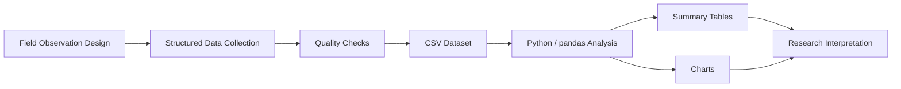

# Research and Data Workflow

## Repository workflow
1. Define a repeatable observation template.
2. Record site-level indicators such as clarity, litter, vegetation, odor and algae presence.
3. Store observations in a tabular dataset.
4. Validate types and allowed ranges.
5. Group observations by nearby urban-pressure category.
6. Produce summary statistics and visual outputs.
7. Interpret patterns cautiously, distinguishing association from causation.

## Data storage
The primary portfolio dataset is CSV for transparency and ease of review. `schema.sql` provides a relational representation with constraints that could be used to load the same observation model into SQLite or another SQL database.

## Integrity note
The included data is illustrative reconstructed portfolio data. The workflow demonstrates research and analysis capability; the values are not presented as the original measurements collected during the academic study.
